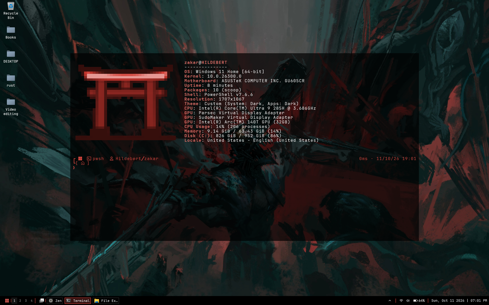
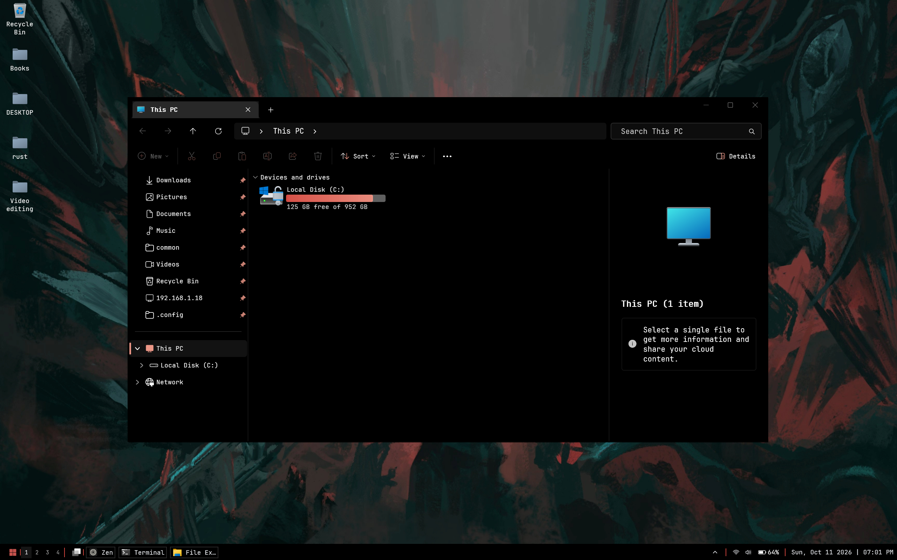
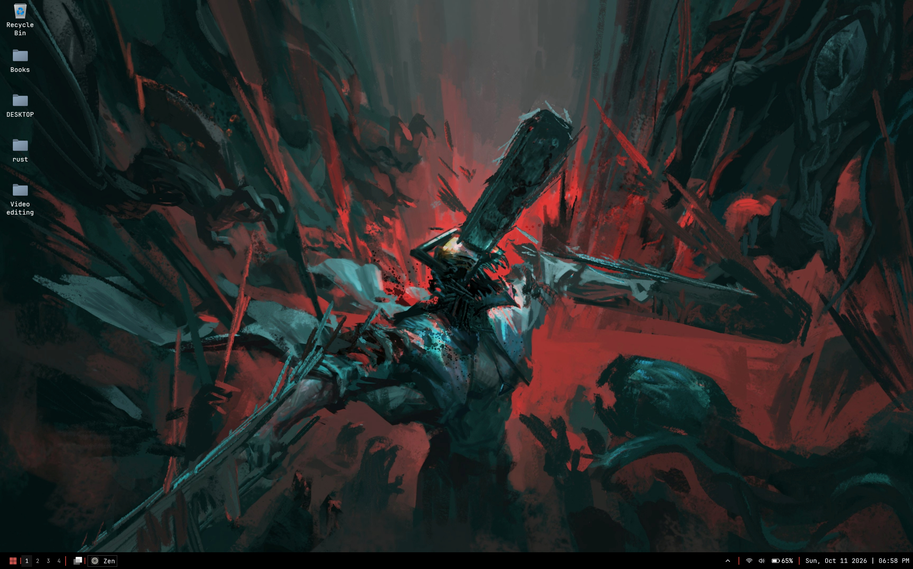
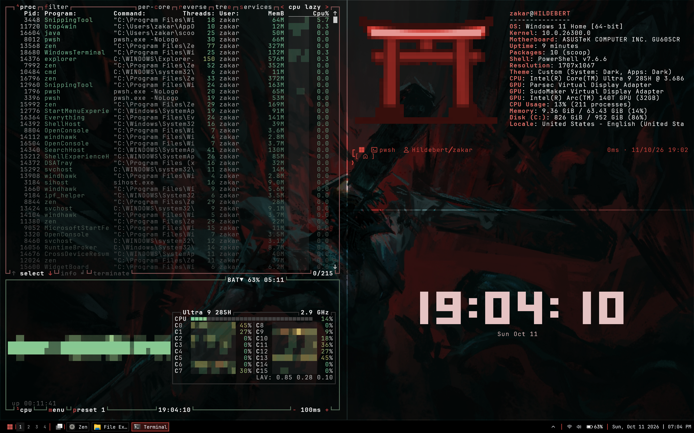

# My-Dot-Files

My personal Windows desktop setup and customization files.

## Screenshots

### Desktop and terminal

### File Explorer

### Clean desktop

### Desktop with system monitoring

## Requirements

To install this setup, you need:

- [Windhawk Services Backup Utility — release 2.1.1](https://github.com/scorpion421/Windhawk-Services-Backup-Utility/releases/tag/2.1.1)
- The required Windows Registry edit for this setup.

**Back up your registry and current Windhawk configuration before applying changes.** Review the registry file before importing it, and make sure you understand which settings it changes.

## Installation

1. Back up your current Windhawk configuration and Windows Registry.
2. Download and use [Windhawk Services Backup Utility 2.1.1](https://github.com/scorpion421/Windhawk-Services-Backup-Utility/releases/tag/2.1.1).
3. Apply the required registry edit.
4. Install or restore the configuration files from this repository.
5. Restart affected applications or Windows if required.

Some customizations may depend on your Windows build, installed applications, and enabled Windhawk mods.

## Repository

[Browse the repository files](https://github.com/Zakaria-Hosam/My-Dot-Files/tree/main)
